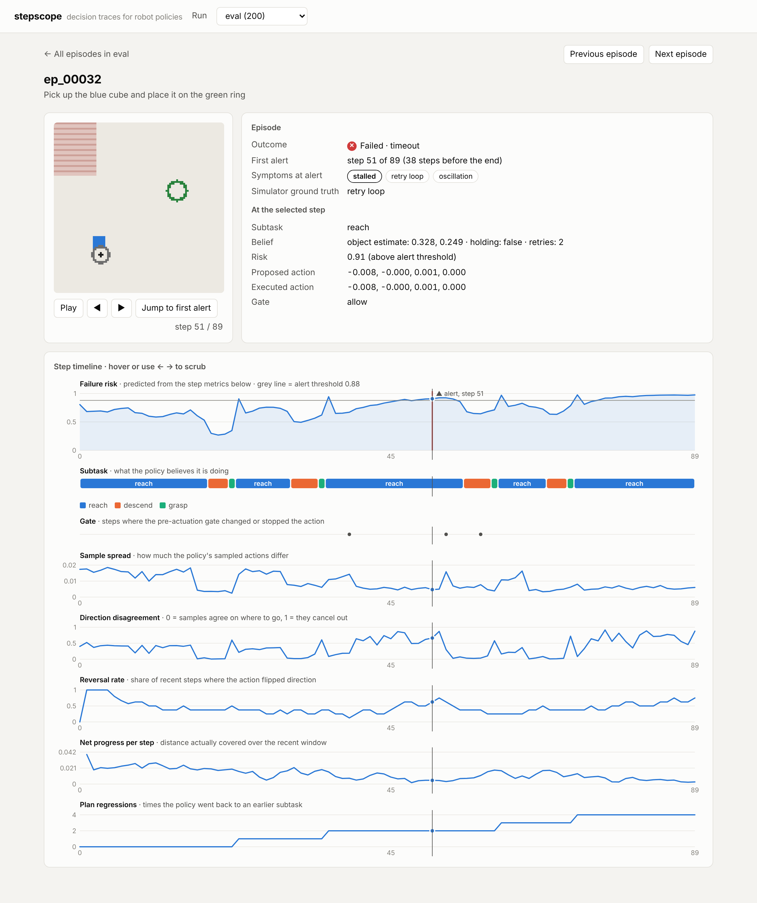

# stepscope

Step-level decision tracing, failure prediction and pre-actuation gating for robot policies.

Robot data tools record what the robot sensed and did. stepscope records what the
policy *decided* at every step (its belief, its plan step, how much its sampled
actions disagreed), turns that into a live failure-risk score, and puts a hard
safety gate between the policy and the actuators.



## What is in the box

| Piece | What it does | Where |
|---|---|---|
| Tracing SDK | Wraps a policy loop in a few lines. Writes plain Parquet + JSON + PNG. | `src/stepscope/tracer.py`, `store.py` |
| Step metrics | Sample spread, direction disagreement, reversals, path efficiency, net progress, plan regressions, subgoal dwell. Computed online. | `metrics.py` |
| Failure predictor | Logistic regression over the step metrics. Gives a risk score per step, an alert threshold calibrated to a false-alarm rate, and the leading symptoms at alert time. | `predictor.py`, `evaluate.py` |
| Gate | Declarative constraints checked before every action: speed limit, workspace box, keep-out zones, halt on sustained risk. | `gate.py` |
| Viewer | Fleet overview and a per-episode timeline with camera, belief, risk, gate events and metrics in sync. | `server.py`, `viewer/index.html` |
| Simulator | A numpy tabletop pick-and-place task and a scripted policy with realistic failure modes, so everything runs with no robot or GPU. | `sim/` |
| Gymnasium adapter | Trace any Gymnasium-style environment. | `adapters/gym.py` |

## Quick start

```bash
pip install -e ".[dev]"
```

```bash
stepscope demo
```

```bash
stepscope serve --runs runs
```

`stepscope demo` takes under a minute. It collects 400 training episodes, trains
the predictor, scores 200 held-out episodes live, then re-runs those same
episodes with the gate halting on high risk. The viewer opens on
http://127.0.0.1:8321.

## Results on the built-in simulator

From `stepscope demo` (200 held-out episodes, 42 of which fail):

| | Failures flagged | False alarms | Median warning before the end |
|---|---|---|---|
| stepscope | 34 / 42 (81%) | 7 / 158 (4%) | 58 steps |
| Elapsed-time-only baseline | 40 / 42 (95%) | 3 / 158 (2%) | 8 steps |

- Episodes last at most 90 steps, so the median alert comes about a third of the way in.
- With the gate halting on sustained risk, 34 of 42 failures stop early and robot
  steps spent on failing episodes drop from 3,722 to 1,978. The cost is 7 of 158
  would-be successes halted by mistake.
- The leading symptom at alert time matches the simulator's ground-truth cause in
  59% of flagged failures.

**Read these numbers as a pipeline check, not as evidence about real robots.** The
simulator and its failure modes were written alongside the metrics, so the
metrics are well matched to them. The numbers that matter will come from a real
policy (see the roadmap).

## Trace your own policy

```python
from stepscope import Gate, Predictor, TraceConfig, Tracer

tracer = Tracer(
    "runs/my-run",
    config=TraceConfig(position_dims=[0, 1, 2], motion_dims=[0, 1, 2], max_steps=300),
    gate=Gate.from_file("examples/gate.yaml"),          # optional
    predictor=Predictor.load("models/predictor.json"),  # optional
)

with tracer.episode(task="pick up the cube") as ep:
    obs = env.reset()
    while True:
        samples = policy.sample_actions(obs, n=8)      # (N, action_dim)
        decision = ep.step(
            state=obs["state"],
            action=samples[0],
            action_samples=samples,   # optional: enables uncertainty metrics
            frame=obs["image"],       # optional: camera frame
            belief={"subtask": "reach"},  # optional: anything the policy believes
            plan_step=0,              # optional: enables plan-progress metrics
        )
        if decision.halt:
            ep.end(success=False, reason="halted_by_gate")
            break
        obs, done, success = env.step(decision.action)  # execute the gated action
        if done:
            ep.end(success=success)
            break
```

A runnable version is in `examples/quickstart.py`. To train a predictor on your
own traces: `stepscope train --run runs/my-run --out models/predictor.json`. It
needs both successful and failed episodes.

## Trace format

```
runs/<run>/run.json
runs/<run>/episodes/<id>/meta.json      outcome, alert step, symptoms, your metadata
runs/<run>/episodes/<id>/steps.parquet  one row per step: state, action, executed
                                        action, gate verdict, belief, risk, m_* metrics
runs/<run>/episodes/<id>/frames.png     camera frames as one sprite sheet
```

## Tests

```bash
pytest
```

## Roadmap

1. Run a real open policy (LeRobot diffusion policy or a VLA on LIBERO / PushT)
   through the Gymnasium adapter and see which metrics survive contact with it.
   This needs a GPU and is the first real test of the idea.
2. Model-internal signals: token log-probs and attention for VLAs, denoising
   variance for diffusion policies.
3. MCAP export so traces open in Foxglove.
4. Escalation hooks: on alert, call a larger model or hand off to a human.
5. Fleet storage and comparison across policy versions.

## Limitations

- Only the built-in simulator has been run end to end. The Gymnasium adapter is
  tested on Pendulum with a random policy, not on a learned manipulation policy.
- The gate assumes actions are position deltas on the dims you declare. It is a
  software check, not certified functional safety.
- The predictor is linear and trained per task. It has not been tested across tasks.
